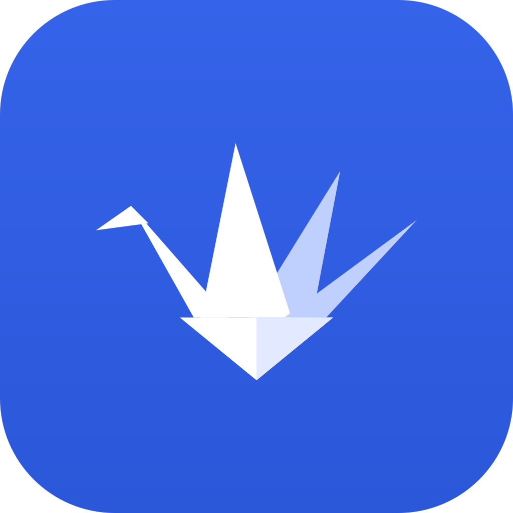
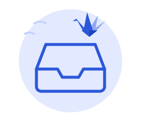

<p align="center">
  
</p>

<h1 align="center">
  <picture>
    <source media="(prefers-color-scheme: dark)" srcset="design/brand/wordmark-white.svg">
    
  </picture>
</h1>

<p align="center">
  A free, open-source email app for Android.<br>
  Fast, private, and built in the open by people and AI agents working together.
</p>

---

> **Status: pre-alpha.** Not ready for everyday use yet. The foundations (**M0**), reading mail (**M1**) and sending mail (**M2**) are built, along with JMAP accounts and most of the everyday features (**M4**), including push wake-ups through UnifiedPush. Sign in with Google is built and waiting for Google to verify the app; Sign in with Microsoft and OpenPGP are still to come. Much of the Android UI has not yet been tested on a real device. Nightly test builds are on the [Download page](https://mailcrane.app/download/). This is a good time to join and help shape it.

## What Mailcrane will be

- **Works with any email provider.** IMAP and SMTP for everyone, JMAP where providers support it, and OAuth sign-in for Gmail, Outlook and Microsoft 365.
- **Private by default.** No tracking, analytics or ads, and no servers of ours reading your mail. Remote images and tracking pixels are blocked until you allow them.
- **Fast and works offline.** Mail is cached on the device, search works without a connection, and messages written offline wait in the outbox.
- **Lots of features.** A unified inbox, conversation threads, full-text search, swipe actions, snooze, scheduled send, multiple accounts, and OpenPGP encryption.
- **Native Android app.** Material 3 Expressive on top of one engine written in Rust.

**iPhone: not before 1.0.** There's no iOS app planned before Mailcrane 1.0 ([decision 0005](docs/decisions/0005-no-ios-before-1-0.md)). The Rust engine stays platform-neutral, so one can follow later.

## Project status

| Area | State |
|---|---|
| Repo, CI, contributor workflow | 🟢 Done: `cargo xtask ci`, cargo-deny licence checks, Dependabot, nightly fuzzing, release-notes script, and Android (Linux) and core (Windows) checks on every PR |
| Rust core: storage and accounts | 🟢 SQLite store with migrations; credentials in Android Keystore; manual and automatic account setup (autoconfig, SRV, bundled ISPDB) |
| Rust core: reading mail (IMAP, MIME) | 🟢 TLS, initial and incremental sync (CONDSTORE/QRESYNC), IDLE, MIME parsing, HTML sanitiser, message actions synced back to the server |
| Rust core: sending mail (SMTP) | 🟢 SMTP over implicit TLS or STARTTLS; reply and forward, attachments, drafts, offline outbox, save to Sent |
| JMAP | 🟢 Connected: sync, actions, sending and folders for JMAP accounts (#266, #272), and push through the account's own server (#387). Not yet tested with a real provider |
| OAuth sign-in (Gmail, Microsoft) | 🟡 Sign in with Google built (#376), waiting for Google's app verification (#44). Microsoft not started (#45) |
| Android app (Kotlin + Jetpack Compose) | 🟡 Message list and view, folders, compose, multiple accounts, threads, search, swipe actions, snooze, scheduled and undo send, rules, widget, tablet layouts, app lock, new-mail notifications (periodic or always-on). push wake-ups through UnifiedPush (#359). Much of it not yet tested on a real device |
| Privacy features | 🟡 Remote content and tracking pixels blocked, tracking parameters stripped from links, one-tap unsubscribe. OpenPGP and S/MIME to come (M5) |
| Website and user docs | 🟢 [mailcrane.app](https://mailcrane.app) (M6-07) |
| Brand and design | 🟢 v1 done (see below) |

The plan is in [ROADMAP.md](ROADMAP.md). The live to-do list is the [issues](../../issues).

## Try it

Mailcrane is pre-alpha: expect rough edges, and don't rely on it for mail you can't lose.

- **Nightly test build:** the [Download page](https://mailcrane.app/download/) links the newest one, built from `main` every night ([docs/releasing.md](docs/releasing.md#nightly-test-builds)). It's signed with a development key, so it updates earlier test builds but not a store or release version.
- **Debug build:** every CI run uploads `android-debug-apk` (see [CONTRIBUTING.md](CONTRIBUTING.md#ci)). It's `app.mailcrane.debug`, so it installs alongside the release app (#406). Its Settings has **Load test mail**, which adds made-up messages that never touch a server.
- **What's built:** IMAP and SMTP accounts with automatic setup, JMAP accounts, reading, sending, search, rules and notifications. **Not yet:** Sign in with Google for everyone (waiting for Google), Sign in with Microsoft, and OpenPGP.
- **Reporting a bug:** never include real addresses, message content or passwords. For screenshots, use Load test mail in a debug build.

## How it works

```
┌──────────────────────┐
│  Android app         │
│  Kotlin · Compose M3 │
└──────────┬───────────┘
           │   generated bindings (UniFFI)
┌──────────┴───────────────────────────────────────┐
│  mailcrane-core (Rust)                           │
│  accounts · IMAP/JMAP sync · SMTP · MIME         │
│  SQLite store · search · HTML sanitising         │
└──────────────────────────────────────────────────┘
```

Mail logic is written in Rust; the app has a native UI on top. Details and reasons: [docs/architecture.md](docs/architecture.md).

| Folder | What's in it |
|---|---|
| `core/` | Rust workspace: the mail engine, the FFI layer, fake test servers, fuzz targets (`core/fuzz/`) and `xtask` |
| `android/` | Android app (Kotlin, Jetpack Compose, Material 3) |
| `design/` | Logo, app icons, UI icons, illustrations and colours |
| `docs/` | Architecture, decisions and changelog fragments |
| `tests/fixtures/` | Made-up test emails. Never real mail. |

## Brand and design

<p>
  
  
  
</p>

**The mark** is a geometric origami crane in flat folds: one shape for both the bird and folded mail. On the app icon it's white on Crane blue.

**Style:** flat UI with a single blue accent, and 24 px line icons with a 1.75 stroke and round caps. **Typeface:** [DM Sans](https://fonts.google.com/specimen/DM+Sans) (Open Font License); the wordmark is DM Sans Bold converted to outlines.

| Token | Light | Dark |
|---|---|---|
| primary (Crane blue) | `#2B57D9` | `#8FA8FF` |
| primaryDark | `#1E44B8` | |
| primaryContainer | `#E3EAFF` | |
| tint | `#BFD0FF` | |
| ink | `#141A2E` | `#E8ECF8` |
| inkMuted | `#5A6380` | `#9AA3BF` |
| surface | `#FFFFFF` | `#0F1424` |
| outline | `#D5DBEA` | `#2A3350` |
| error / success | `#C62828` / `#157A4C` | `#F28B82` / `#3DBE83` |

The colours live in [`design/colors.json`](design/colors.json), and apps read them from there. Never hard-code a colour.

**What's in [`design/`](design/)** (all generated by `design/build.py`):

| Asset | Path |
|---|---|
| Crane mark and wordmark (colour, white, mono; SVG + PNG) | `design/brand/` |
| Android adaptive icon, themed-icon layer, legacy PNGs | `design/app-icon/android/res/` |
| Play Store icon (512 px) | `design/app-icon/android/playstore-icon-512.png` |
| Splash icons (Android 12+) | `design/splash/` |
| 25 UI icons (SVG and Android VectorDrawable) | `design/ui-icons/` |
| Empty-state illustrations | `design/illustrations/` |

See [design/README.md](design/README.md) for where each file goes and how to rebuild them.

## Building

**You need:** Rust via `rustup` (`rust-toolchain.toml` picks the version). For the app, JDK 17+, the Android SDK and NDK, the Android Rust targets and `cargo-ndk` (details in [android/README.md](android/README.md)). No Docker or test accounts needed: tests use built-in fake mail servers.

```bash
git clone https://github.com/level-98/mailcrane.git
cd mailcrane

cargo xtask ci          # every check CI runs, in one command
cd android && ./gradlew assembleDebug                    # Android
```

## Want to help?

You don't need to be an expert, and AI tools are welcome. Three steps:

1. Find an unassigned issue, such as a [`good first issue`](../../labels/good%20first%20issue) or [`agent-ready`](../../labels/agent-ready).
2. Comment **`/claim`** on it.
3. Open a PR that says `Closes #<issue>`.

Fixed a bug already? Just open the report and the PR together. More in **[CONTRIBUTING.md](CONTRIBUTING.md)**. Using an AI coding agent? Point it at **[AGENTS.md](AGENTS.md)**.

We'd especially like Rust developers (sync and storage), Android developers, people who can test with lots of email providers, designers, translators and accessibility testers.

Translators: Mailcrane will be translated on Weblate, but the Weblate project isn't open yet. See [docs/translations.md](docs/translations.md).

## Privacy

Mailcrane collects nothing and has no servers of its own: your mail goes only to the mail servers you add. The details, including every other connection the app can make, are in the [privacy policy](docs/privacy.md) (a draft until the first release).

## Security

Please don't report security problems in public issues. See [SECURITY.md](SECURITY.md).

## Licence

[Mozilla Public License 2.0](LICENSE). The brand assets in `design/` are under the same licence, but the Mailcrane name and logo may not be used to suggest that a fork is the official app.
