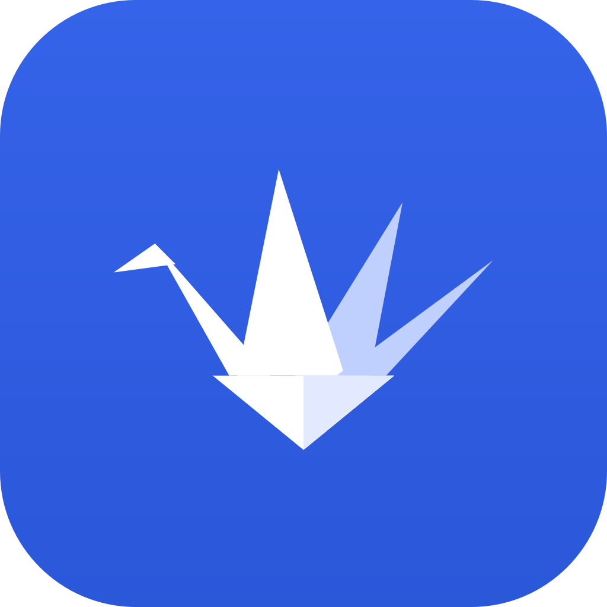

# Design

Mailcrane's brand pack (v1). The mark is a folded paper crane, standing for both the bird and folded mail. Each fold is a separate flat shape.

<p>
  
  &nbsp;
  
  
  
</p>

**Everything here except this README is generated by `build.py`.** To change an asset, change the script and rebuild. Don't hand-edit the outputs.

```bash
python3 design/build.py
```

It needs `rsvg-convert`, ImageMagick (`convert`) and the Python `fontTools` package. The wordmark is built from DM Sans Bold: set `DMSANS_TTF` to the font file if it isn't at the Google Fonts path in the script. Running it deletes and rebuilds only the generated folders listed below.

## Colours (`colors.json`)

Both apps read their colours from this file. Never hard-code a colour.

| Token | Light | Dark |
|---|---|---|
| primary (Crane blue) | `#2B57D9` | `#8FA8FF` |
| primaryDark | `#1E44B8` | |
| primaryContainer | `#E3EAFF` | |
| tint | `#BFD0FF` | |
| ink | `#141A2E` | `#E8ECF8` |
| inkMuted | `#5A6380` | `#9AA3BF` |
| surface | `#FFFFFF` | `#0F1424` |
| surfaceDim / surfaceHigh | `#F4F6FB` | `#1A2138` |
| outline | `#D5DBEA` | `#2A3350` |
| error | `#D93B3B` | |
| success | `#1F9D63` | |

Typeface: **DM Sans** (Open Font License). The wordmark is Bold converted to outlines, so it doesn't need the font installed.

## Regenerating app themes

Change a brand colour in `colors.json`, then run `python3 design/gen_theme.py` to regenerate the Android Compose and iOS asset themes together. Run `python3 design/gen_theme.py --check` in CI to ensure generated files match the JSON.

## Folders

| Path | Contents | Where it goes |
|---|---|---|
| `brand/` | Crane mark and wordmark in colour, white and mono, as SVG with PNG copies | Website, README, docs |
| `app-icon/icon-master.svg` | 1024 px icon source | |
| `app-icon/ios/AppIcon.appiconset/` | Single 1024 px icon, no alpha (Xcode 14+) | `ios/…/Assets.xcassets` |
| `app-icon/android/res/` | Adaptive icon: vector foreground, colour background, monochrome layer for Android 13 themed icons, plus legacy PNGs for every density | Merge into `android/app/src/main/res` |
| `app-icon/android/playstore-icon-512.png` | Play Console listing icon | |
| `splash/` | Android 12+ splash icon (content inside the 192 dp circle) and iOS launch logo @1x/2x/3x | |
| `ui-icons/svg/` | 24 line icons, 24 px, 1.75 stroke, `currentColor` | iOS (as SVG assets) |
| `ui-icons/android-vector/` | The same icons as tintable VectorDrawables, `ic_mc_*.xml` | `android/app/src/main/res/drawable` |
| `illustrations/` | Empty inbox, no results, welcome (SVG, and PNG @3x) | Empty states |

The 24 UI icons: account, archive, attach, back, check, close, compose, drafts, folder, forward, inbox, label, mail, menu, more, refresh, reply, search, sent, settings, snooze, spam, star, trash.

## Splash screens

- **Light:** background `#2B57D9` with `splash-icon.svg` (white), or `#FFFFFF` with `splash-icon-color.svg`.
- **Dark:** background `#0F1424` with the white icon.

Android 12+ theme:

```xml
<item name="windowSplashScreenBackground">@color/ic_launcher_background</item>
<item name="windowSplashScreenAnimatedIcon">@drawable/ic_launcher_foreground</item>
```

## Licence

Under the project's MPL-2.0, like the code. The Mailcrane name and logo may not be used to suggest that a fork is the official app.
